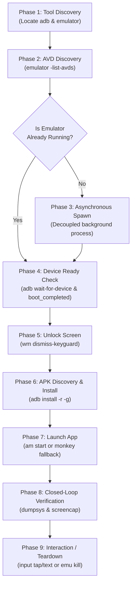

# 🤖 Agent Operational Manual: Controlling Android Emulators from Laptop CLI

> **Target Audience:** Autonomous Coding Agents (AGY, Claude Code, Cursor, OpenCode) and Automation Scripts.  
> **Environment:** Host Laptop (Windows PowerShell, macOS Terminal, Linux Bash).  
> **Interface:** Non-interactive CLI (`run_command` / subprocess tool calls) via `adb` and `emulator`.

---

## ⚡ The 4 Golden Rules for Coding Agents

1. **NEVER run `emulator` synchronously in your tool shell:**  
   The `emulator` command stays open as long as the virtual device runs. If you execute `emulator -avd <name>` directly, your agent tool call will hang until timeout. Always decouple the process using background execution (`Start-Process` in PowerShell, `start ""` in CMD, `nohup ... &` in Bash).
2. **NEVER rely on static sleep timers:**  
   Emulators take anywhere from 10 seconds to 3 minutes to boot depending on cold-start vs snapshot and laptop load. Always poll `adb shell getprop sys.boot_completed` deterministically.
3. **ALWAYS dismiss the keyguard after boot:**  
   Even if an emulator finishes booting, the screen lock / keyguard is often active. You must dismiss it with `adb shell wm dismiss-keyguard` or `input keyevent 82` before launching apps or sending inputs.
4. **ALWAYS verify with visual inspection (Screencap):**  
   Don't assume `am start` succeeded just because exit code was 0. Confirm by inspecting foreground window state or dumping `screencap -p` to verify the UI.

---

## 🧭 End-to-End Execution Flow



---

## 🛠️ Phase 1: Environment & Tool Discovery

An agent must verify that Android SDK command-line tools are available. Standard default paths on laptops:

| OS | Default Emulator Path | Default ADB Path |
| :--- | :--- | :--- |
| **Windows** | `$env:LOCALAPPDATA\Android\Sdk\emulator\emulator.exe` | `$env:LOCALAPPDATA\Android\Sdk\platform-tools\adb.exe` |
| **macOS** | `~/Library/Android/sdk/emulator/emulator` | `~/Library/Android/sdk/platform-tools/adb` |
| **Linux** | `~/Android/Sdk/emulator/emulator` | `~/Android/Sdk/platform-tools/adb` |

### Agent Discovery Script (PowerShell — Windows)
```powershell
# 1. Resolve ADB
$adbCmd = if (Get-Command adb -ErrorAction SilentlyContinue) { "adb" } 
          elseif (Test-Path "$env:LOCALAPPDATA\Android\Sdk\platform-tools\adb.exe") { "$env:LOCALAPPDATA\Android\Sdk\platform-tools\adb.exe" }
          else { throw "ADB not found. Ensure Android SDK Platform-Tools are installed." }

# 2. Resolve Emulator
$emuCmd = if (Get-Command emulator -ErrorAction SilentlyContinue) { "emulator" }
          elseif (Test-Path "$env:LOCALAPPDATA\Android\Sdk\emulator\emulator.exe") { "$env:LOCALAPPDATA\Android\Sdk\emulator\emulator.exe" }
          else { throw "Emulator executable not found." }

Write-Output "ADB: $adbCmd | Emulator: $emuCmd"
```

### Agent Discovery Script (Bash — macOS / Linux)
```bash
ADB_CMD=$(command -v adb || echo "$HOME/Library/Android/sdk/platform-tools/adb" || echo "$HOME/Android/Sdk/platform-tools/adb")
EMU_CMD=$(command -v emulator || echo "$HOME/Library/Android/sdk/emulator/emulator" || echo "$HOME/Android/Sdk/emulator/emulator")

if [ ! -x "$ADB_CMD" ] && ! command -v adb >/dev/null 2>&1; then
    echo "ERROR: adb not found" && exit 1
fi
echo "ADB: $ADB_CMD | Emulator: $EMU_CMD"
```

---

## 📱 Phase 2: Virtual Device (AVD) Enumeration

Before booting, identify the name of the installed Android Virtual Device (AVD):

```powershell
# List available AVDs
& $emuCmd -list-avds
```

If multiple AVDs are returned, an agent should select the first one, or pick one matching project criteria (e.g., `Small_Phone`, `Pixel_7_API_34`).

```powershell
$targetAvd = (& $emuCmd -list-avds | Select-Object -First 1).Trim()
if (-not $targetAvd) {
    throw "No AVDs found! Create one using Android Studio Device Manager or avdmanager."
}
Write-Output "Selected AVD: $targetAvd"
```

---

## 🚀 Phase 3: Launching the Simulator in Background

### ⚠️ Critical Warning for Agents
Never run the emulator directly in the foreground. Use non-blocking process spawn.

### Option A: Interactive Windowed Mode (Default for Laptop Testing)
Opens the emulator UI window on the laptop display so a human or screencap tool can see it.

**Windows PowerShell:**
```powershell
# Check if emulator is already running
$running = & $adbCmd devices | Select-String "emulator-"
if (-not $running) {
    Write-Output "Starting emulator $targetAvd in background..."
    Start-Process -FilePath $emuCmd -ArgumentList "-avd $targetAvd" -WindowStyle Normal
} else {
    Write-Output "Emulator is already online."
}
```

**macOS / Linux Bash:**
```bash
if ! $ADB_CMD devices | grep -q "emulator-"; then
    echo "Starting emulator $TARGET_AVD in background..."
    nohup "$EMU_CMD" -avd "$TARGET_AVD" > /dev/null 2>&1 &
fi
```

### Option B: Headless Mode (Fast, Background, CI/Testing)
If the laptop has limited RAM/GPU or the agent only needs programmatic interaction without a visible desktop window:

```powershell
Start-Process -FilePath $emuCmd -ArgumentList "-avd $targetAvd -no-window -no-audio -gpu swiftshader_indirect"
```

### Useful Emulator Flags for Agents
- `-no-snapshot-load`: Forces a cold boot (useful when app state is corrupted).
- `-no-boot-anim`: Skips boot animation to shave 5–10 seconds off startup.
- `-read-only`: Runs from snapshot without persisting disk modifications.
- `-wipe-data`: Resets the virtual device to factory state.

---

## ⏳ Phase 4: Deterministic Readiness Polling

Do not use hardcoded `Start-Sleep 30`. Use this exact polling loop:

```powershell
Write-Output "Waiting for emulator ADB bridge..."
& $adbCmd wait-for-device

Write-Output "Waiting for system boot completion..."
$timeoutSec = 180
$elapsed = 0
$booted = $false

while ($elapsed -lt $timeoutSec) {
    $status = (& $adbCmd shell getprop sys.boot_completed 2>$null).Trim()
    if ($status -eq "1") {
        # Double check Package Manager service is alive
        $pmReady = (& $adbCmd shell pm path android 2>$null)
        if ($pmReady -like "*package:*") {
            $booted = $true
            break
        }
    }
    Start-Sleep -Seconds 2
    $elapsed += 2
}

if (-not $booted) {
    throw "Emulator failed to complete boot within $timeoutSec seconds."
}
Write-Output "Emulator booted successfully! (Took ${elapsed}s)"
```

### Screen Unlock & Wakeup
Emulators frequently boot to a dimmed or locked screen. Agents must run:
```powershell
# Wake screen up
& $adbCmd shell input keyevent 26
# Dismiss keyguard / lock screen
& $adbCmd shell wm dismiss-keyguard
# Press Menu/Unlock fallback
& $adbCmd shell input keyevent 82
```

---

## 📦 Phase 5: APK Discovery & Installation

### 1. Locate the APK
Common build output directories in standard Android projects:
- Gradle Debug: `<project_root>/android/app/build/outputs/apk/debug/app-debug.apk`
- React Native / Expo: `<project_root>/android/app/build/outputs/apk/debug/app-debug.apk`
- Flutter: `<project_root>/build/app/outputs/flutter-apk/app-debug.apk`

### 2. Install with Automatic Permission Grant
Always use `-r` (reinstall keeping data), `-d` (allow version downgrade), and `-g` (grant all runtime permissions automatically):

```powershell
$apkPath = "D:\projects\thik-ache-kina\android\app\build\outputs\apk\debug\app-debug.apk"
Write-Output "Installing $apkPath..."
& $adbCmd install -r -d -g $apkPath
```

---

## 🎯 Phase 6: Resolving App Package & Launch Activity

If the agent doesn't know the package name or main activity:

### Method A: Extract from APK using `aapt` (Best before install)
```powershell
# Find aapt / aapt2 in Android build-tools
$aapt = (Get-ChildItem -Path "$env:LOCALAPPDATA\Android\Sdk\build-tools" -Filter "aapt.exe" -Recurse | Select-Object -First 1).FullName

if ($aapt) {
    $badging = & $aapt dump badging $apkPath
    $pkgName = ($badging | Select-String "package: name='([^']+)'").Matches.Groups[1].Value
    $launchActivity = ($badging | Select-String "launchable-activity: name='([^']+)'").Matches.Groups[1].Value
    Write-Output "Detected: $pkgName / $launchActivity"
}
```

### Method B: Resolve directly from Device Package Manager (After install)
```powershell
# If package name is known (e.g. com.agentremote), resolve its default launcher activity:
$pkgName = "com.agentremote"
$resolveOutput = & $adbCmd shell cmd package resolve-activity --brief $pkgName
$launchActivity = ($resolveOutput | Select-String "$pkgName/").Line.Trim()
Write-Output "Resolved Activity: $launchActivity"
```

---

## 🚀 Phase 7: Launching the App

# Primary Method: Direct Explicit Activity Launch (Debug package: com.agentremote.debug)
adb shell am start -n "com.agentremote.debug/com.agentremote.MainActivity" -a android.intent.action.MAIN -c android.intent.category.LAUNCHER

# Fallback: Monkey Launcher
adb shell monkey -p com.agentremote.debug -c android.intent.category.LAUNCHER 1

---

## 🔍 Phase 8: Verification & Multimodal Feedback

How an agent confirms the app actually launched and is functioning:

### 1. Check Focused Activity
```powershell
# Verify that the package is currently on top of the window stack
$currentFocus = & $adbCmd shell dumpsys window | Select-String "mCurrentFocus"
Write-Output $currentFocus

if ($currentFocus -notlike "*$pkgName*") {
    Write-Warning "App may not be in foreground! Current focus: $currentFocus"
}
```

### 2. Capture Visual Screenshot (For Multimodal Inspection)
Capture the screen directly to a PNG file on the laptop:
```powershell
$screenshotPath = "$PWD\emulator_verification.png"
& $adbCmd exec-out screencap -p > $screenshotPath
Write-Output "Screenshot saved to $screenshotPath"
```
*(Multimodal agents can now inspect `emulator_verification.png` to confirm render state).*

### 3. Dump UI Hierarchy XML (DOM Inspection)
To read labels, button bounds, and text on screen without computer vision:
```powershell
& $adbCmd shell uiautomator dump /data/local/tmp/uidump.xml
& $adbCmd pull /data/local/tmp/uidump.xml ./uidump.xml
# Search for specific UI elements
Select-String -Path ./uidump.xml -Pattern 'text="([^"]+)"'
```

---

## 🎮 Phase 9: Automated App Driving & Control

Agents can simulate touch, keyboard input, and hardware buttons:

| Action | ADB Command | Description |
| :--- | :--- | :--- |
| **Tap Coordinates** | `adb shell input tap <X> <Y>` | Tap a specific pixel point |
| **Type ASCII Text** | `adb shell input text "<text>"` | Type text (spaces must be `%s`) |
| **Press Back** | `adb shell input keyevent 4` | Go back |
| **Press Home** | `adb shell input keyevent 3` | Return to home screen |
| **Press Enter** | `adb shell input keyevent 66` | Submit form / newline |
| **Press Tab** | `adb shell input keyevent 61` | Move focus to next input field |
| **Swipe / Scroll** | `adb shell input swipe X1 Y1 X2 Y2 [ms]` | Scroll down: `input swipe 500 1500 500 500 300` |

### Typing Strings with Special Characters / Spaces
Standard `input text` chokes on spaces and symbols. Use either:
```powershell
# Replace spaces with %s
$text = "Hello World".Replace(" ", "%s")
& $adbCmd shell input text $text
```
Or set text into device clipboard and paste:
```powershell
& $adbCmd shell cmd clipboard set text "Complex String 123!@#"
& $adbCmd shell input keyevent 279  # PASTE keyevent
```

---

## 🛑 Phase 10: Lifecycle & Cleanup

### Force-Stop App
```powershell
& $adbCmd shell am force-stop $pkgName
```

### Clear App Cache & Data
```powershell
& $adbCmd shell pm clear $pkgName
```

### Gracefully Shutdown Emulator
```powershell
# Discover device serial (e.g., emulator-5554)
$deviceSerial = (& $adbCmd devices | Select-String "emulator-\d+").Matches.Value
if ($deviceSerial) {
    & $adbCmd -s $deviceSerial emu kill
    Write-Output "Emulator $deviceSerial shut down gracefully."
}
```

---

## 🩺 Phase 11: Agent Troubleshooting Decision Tree

```
Issue: Emulator hangs during startup / high CPU usage
├── Check if virtualization is enabled in BIOS / Windows Features (Hyper-V / WHPX).
└── Fix: Launch with software GPU:
    emulator -avd <Name> -gpu swiftshader_indirect

Issue: adb devices shows "emulator-5554 offline" or "unauthorized"
├── Fix 1: adb reconnect offline
└── Fix 2: adb kill-server; adb start-server; adb devices

Issue: App crashes immediately on launch (Crash Loop)
├── Inspect crash logcat:
│   adb logcat -d -b crash
└── Inspect error lines:
    adb logcat -d *:E | Select-Object -Last 50

Issue: "INSTALL_FAILED_INSUFFICIENT_STORAGE"
└── Fix: Launch emulator with extra partition size:
    emulator -avd <Name> -partition-size 4096
```

---

## ⚡ Complete One-Click Agent PowerShell Script

Save this snippet as a standard callable function in any agent run:

```powershell
function Launch-AndroidAppInEmulator {
    param (
        [string]$AvdName = "Small_Phone",
        [string]$ApkPath = "",
        [string]$PackageName = "com.agentremote.debug",
        [string]$ActivityName = "com.agentremote.MainActivity"
    )

    $emu = "$env:LOCALAPPDATA\Android\Sdk\emulator\emulator.exe"
    $adb = "adb"

    # 1. Start Emulator if not running
    if (-not (& $adb devices | Select-String "emulator-")) {
        Write-Host "[*] Launching emulator $AvdName..."
        Start-Process -FilePath $emu -ArgumentList "-avd $AvdName -no-boot-anim"
        Write-Host "[*] Waiting for ADB connection..."
        & $adb wait-for-device
    }

    # 2. Wait for boot completion
    Write-Host "[*] Waiting for OS boot..."
    $ready = $false
    for ($i = 0; $i -lt 60; $i++) {
        if ((& $adb shell getprop sys.boot_completed 2>$null).Trim() -eq "1") {
            $ready = $true; break
        }
        Start-Sleep -Seconds 2
    }
    if (-not $ready) { throw "Emulator boot timeout." }

    # 3. Dismiss Lockscreen & Setup Port Forwarding
    & $adb shell wm dismiss-keyguard
    & $adb shell input keyevent 82
    & $adb reverse tcp:8765 tcp:8765

    # 4. Install APK if provided
    if ($ApkPath -and (Test-Path $ApkPath)) {
        Write-Host "[*] Installing APK: $ApkPath"
        & $adb install -r -d -g $ApkPath
    }

    # 5. Launch App
    Write-Host "[*] Launching $PackageName..."
    & $adb shell am start -n "$PackageName/$ActivityName"
    if ($LASTEXITCODE -ne 0) {
        & $adb shell monkey -p $PackageName -c android.intent.category.LAUNCHER 1
    }

    # 6. Verify Focus
    Start-Sleep -Seconds 2
    $focus = & $adb shell dumpsys window | Select-String "mCurrentFocus"
    Write-Host "[OK] Current Focus: $focus"
}
```
