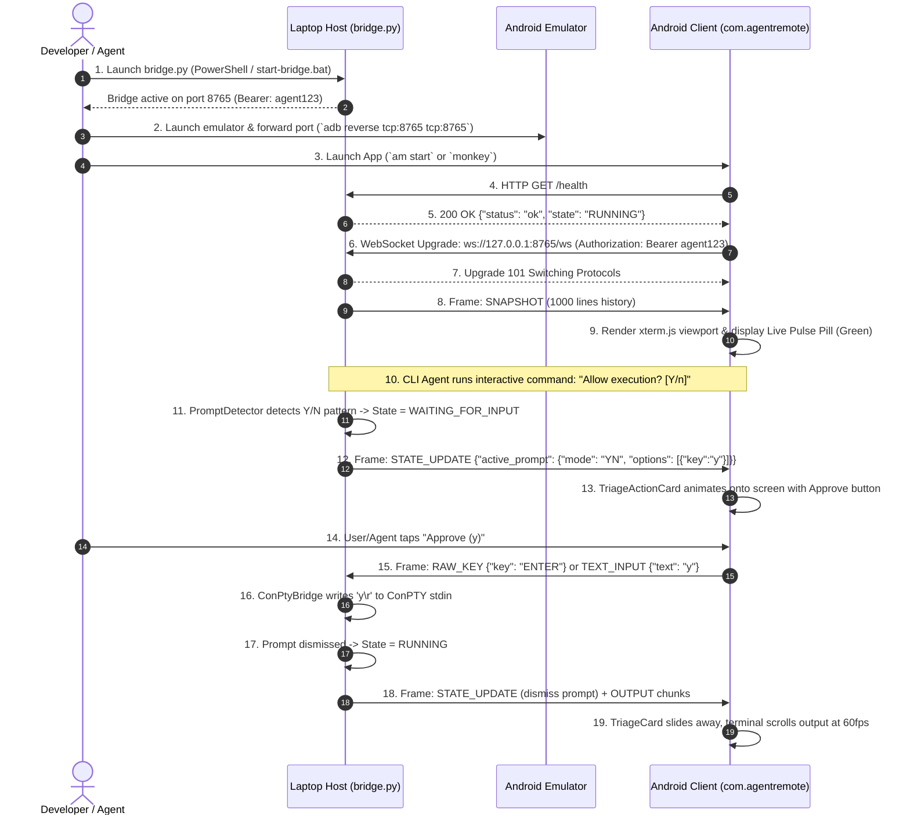

# 📡 Agent Guide: Desktop-to-Mobile Communication, Directory Manual, & Testing Protocol

> **Purpose:** This manual instructs autonomous coding agents on how the desktop bridge host daemon and the Android client app (running in the local Android emulator) communicate, how to navigate and operate the workspace directory, how to trace the user journey, and how to execute step-by-step unit, security, integration, and UI verification tests.

---

## 🏛️ 1. Architecture: How Desktop & Android Simulator Communicate

```
┌────────────────────────────────────────────────────────────────────────┐
│                        💻 WINDOWS HOST LAPTOP                          │
│                                                                        │
│   CLI Agent (AGY / OpenCode / Claude)                                  │
│         ↕  (Raw VT100 / stdin / stdout via pywinpty ConPTY)           │
│   bridge.py Daemon [Session 1 Interactive]                             │
│   ├─ Circular Ring Buffer (1,000 lines history)                        │
│   ├─ Prompt Detector (RegEx heuristics: Y/N, Numbered, Inputs)         │
│   ├─ Pairing Manager (ECDSA P-256 + TOTP + Bearer Token)               │
│   └─ aiohttp WebSocket Server (0.0.0.0:8765)                           │
│         ▲                                    ▲                         │
└─────────┼────────────────────────────────────┼─────────────────────────┘
          │ (Option B: ADB Reverse Tunnel)     │ (Option A: Virtual Gateway)
          │   `adb reverse tcp:8765 tcp:8765`   │   `10.0.2.2:8765`
          ▼                                    ▼
┌────────────────────────────────────────────────────────────────────────┐
│                 📱 ANDROID EMULATOR (Small_Phone)                      │
│                                                                        │
│   com.agentremote Native Client                                        │
│   ├─ BridgeClient (OkHttp WebSocket, Auto-reconnect, Ping/Pong 30s)    │
│   ├─ DeviceIdentityManager (Android Keystore P-256 hardware keys)      │
│   ├─ XTermWebView (Local assets/xterm, 60fps ANSI VT rendering)        │
│   ├─ SplitThumbBar (On-screen touch keys: ▲, ▼, Tab, Enter, Ctrl+C)   │
│   └─ TriageActionCard (1-tap approval when prompt detected)            │
└────────────────────────────────────────────────────────────────────────┘
```

### 1.1 Network Routing Between Laptop and Android Simulator
The Android emulator runs inside a QEMU virtualized user-mode network. A coding agent has **two reliable ways** to connect the emulator to the laptop host:

#### Method A: The Android Virtual Host Gateway (`10.0.2.2`)
- **How it works:** Android emulators map `10.0.2.2` directly to the host machine's loopback interface (`127.0.0.1`).
- **Configuration:** Inside the Android app's settings:
  - **Host:** `10.0.2.2`
  - **Port:** `8765`
  - **Auth Token:** Match `security.auth_token` in `agent-bridge/config.yaml` (default: `agent123`).

#### Method B: ADB Reverse Port Tunnel (`localhost` / `127.0.0.1`) — Recommended
- **How it works:** Running `adb reverse tcp:8765 tcp:8765` instructs the Android device kernel to forward any connection made to its local port 8765 back through the USB/ADB bridge to the laptop host's port 8765.
- **Configuration:**
  - Execute: `adb reverse tcp:8765 tcp:8765`
  - Inside the Android app settings, set **Host:** `127.0.0.1` or `localhost`.
- **Advantage:** Eliminates IP subnet confusion; works seamlessly regardless of firewall or network adapters.

---

### 1.2 Protocol Specification & Frame Formats

All communication over `ws://<host>:8765/ws` uses strict JSON framing.

#### A. Inbound Frames (Android Client ➡️ Host Bridge)

| Frame Type | Payload Structure | Purpose |
| :--- | :--- | :--- |
| `RAW_KEY` | `{"type": "RAW_KEY", "key": "UP"}` | Virtual terminal key (`UP`, `DOWN`, `ENTER`, `SPACE`, `TAB`, `ESC`, `SIGINT`, `EOF`). Mapped directly to ConPTY VT escape codes (e.g. `\x1b[A`, `\x03`). |
| `TEXT_INPUT` | `{"type": "TEXT_INPUT", "text": "npm test"}` | Text string. The bridge sanitizes trailing newlines and appends carriage return `\r` for Windows ConPTY. |
| `STREAM_INPUT`| `{"type": "STREAM_INPUT", "data": "abc"}` | Raw character stream (e.g. typing directly into terminal). Translates `\x7f` to ConPTY backspace `\x08`. |
| `RESIZE` | `{"type": "RESIZE", "cols": 90, "rows": 32}` | Dynamically resizes the virtual ConPTY grid when mobile viewport rotates or resizes. |
| `REQUEST_REFRESH`| `{"type": "REQUEST_REFRESH"}` | Demands a clean full snapshot re-hydration from the ring buffer. |
| `DISMISS_PROMPT` | `{"type": "DISMISS_PROMPT"}` | Clears active prompt latch and broadcasts updated state to all connected clients. |

#### B. Outbound Frames (Host Bridge ➡️ Android Client)

| Frame Type | Payload Structure | Purpose |
| :--- | :--- | :--- |
| `SNAPSHOT` | `{"type": "SNAPSHOT", "payload": {"session_id": "...", "state": "RUNNING", "history": [...], "active_prompt": null}}` | Sent **immediately** upon WebSocket connection to hydrate the mobile xterm terminal with the last 1,000 lines. |
| `OUTPUT` | `{"type": "OUTPUT", "data": "\x1b[32mBuild Succeeded\x1b[0m"}` | Real-time terminal output stream. **MTU framed** to `<= 1400 bytes` per chunk to prevent packet fragmentation. |
| `STATE_UPDATE` | `{"type": "STATE_UPDATE", "payload": {"state": "WAITING_FOR_INPUT", "active_prompt": {"headline": "...", "mode": "YN", "options": [...]}}}` | Broadcast whenever the agent transitions state (e.g. waiting for user confirmation). Triggers `TriageActionCard`. |

---

### 1.3 Security & Authentication Defense Layers

1. **CSWSH Defense (Cross-Site WebSocket Hijacking):**  
   The bridge inspects the HTTP `Origin` header. If a browser `Origin` header is present, it is rejected with `HTTP 403 Forbidden` unless `allow_browser_origin: true` is configured. Native Android OkHttp does not send a browser origin.
2. **Bearer Token Authentication:**  
   The client passes `Authorization: Bearer <token>` in the upgrade request or `?token=<token>`. Constant-time comparison (`secrets.compare_digest`) prevents timing attacks.
3. **Hardware Key Cryptographic Identity (ECDSA P-256):**  
   The mobile client generates a keypair in Android Keystore (hardware-backed). During QR onboarding, it signs a challenge. Subsequent requests send headers `X-Device-Pubkey`, `X-Auth-Nonce`, and `X-Auth-Signature`.
4. **Ghost Connection Preemption (INV-04):**  
   When a mobile device reconnects after a network switch, any stale socket is immediately closed with code `1000 ("Superseded by new connection")`, preventing deadlocks.

---

## 📂 2. Directory Layout & Component Manual

```
thik-ache-kina/
├── agent-bridge/                     # Python Host Daemon & Desktop Tray
│   ├── bridge.py                     # Core host daemon (ConPTY + WebSocket + Prompts)
│   ├── ws_server.py                  # aiohttp WebSocket server & security handlers
│   ├── pty_wrapper.py                # ConPTY (pywinpty) child process supervisor
│   ├── ring_buffer.py                # 1,000-line circular terminal history
│   ├── prompt_detector.py            # Real-time regex triage heuristic engine
│   ├── pairing_manager.py            # ECDSA P-256 cryptographic identity manager
│   ├── ipc_server.py                 # Named pipe / local IPC server for desktop tray
│   ├── desktop_tray.py               # Windows System Tray controller & status icon
│   ├── config.yaml                   # Host configuration (ports, tokens, conpty dimensions)
│   └── tests/                        # Pytest suite (core, security, MTU, pairing)
├── android/                          # Native Android Mobile Client (Kotlin + Jetpack Compose)
│   ├── app/src/main/
│   │   ├── java/com/agentremote/
│   │   │   ├── MainActivity.kt       # Single-activity UI entrypoint
│   │   │   ├── data/BridgeClient.kt  # OkHttp WebSocket client & reconnect logic
│   │   │   ├── data/DeviceIdentityManager.kt # Android Keystore P-256 signer
│   │   │   ├── data/TokenStorage.kt  # EncryptedSharedPreferences credentials store
│   │   │   └── ui/                   # Jetpack Compose UI (HomeScreen, TerminalScreen)
│   │   └── assets/xterm/             # Bundled local xterm.js terminal engine
│   └── build.gradle.kts              # Android Gradle build configuration
├── run-apk-on-laptop.bat             # Standalone runner: Boots emulator & installs APK
├── start-bridge.bat                  # Launches bridge.py host daemon
├── build-desktop-exe.bat             # PyInstaller packager for Windows desktop app
├── AGENT_ANDROID_SIMULATOR_MANUAL.md # CLI Emulator boot & APK lifecycle manual
└── COMMUNICATION_AND_TESTING_GUIDE.md# This comprehensive specification and test guide
```

---

## 🚶 3. The End-to-End User Journey



---

## 🧪 4. Agent Step-by-Step Testing & Verification Suite

An agent should execute these test phases **sequentially** to verify the entire system.

### 🔬 Test Level 1: Host Daemon Unit Tests
Verifies ring buffer, prompt heuristics, pairing manager, and MTU chunking.

**Agent Command:**
```powershell
pytest agent-bridge/tests
```
**Expected Output:**
```
19 passed in 3.40s (100% exit code 0)
```

---

### 🛡️ Test Level 2: Host Security Tests
Directly verifies CSWSH defense and token rejection without needing the emulator.

**Agent Command:**
```powershell
pytest agent-bridge/tests/test_security.py -v
```
**Expected Assertions:**
- `test_cswsh_browser_origin_rejection`: Browser with `Origin: http://evil-site.com` receives `HTTP 403 Forbidden`.
- `test_unauthorized_token_rejection`: Missing or invalid Bearer token receives `HTTP 401 Unauthorized`.
- `test_valid_token_connection`: Valid token upgrades and receives initial `SNAPSHOT`.

---

### 🌐 Test Level 3: Network & Connectivity Smoke Tests (Host + Simulator)

When the emulator is running, verify that the host daemon is reachable from within the emulator's network stack.

#### Step 3.1: Ensure ADB Reverse Tunnel is Set
```powershell
adb reverse tcp:8765 tcp:8765
# Verify active reverse forwards
adb reverse --list
```
*Expected Output:* `(reverse) tcp:8765 tcp:8765`

#### Step 3.2: Verify `/health` from Inside Android Shell
The agent queries the bridge health endpoint from inside the emulator OS:
```powershell
# Method A: via ADB reverse tunnel
adb shell "curl -s http://127.0.0.1:8765/health"

# Method B: via Android special host alias
adb shell "curl -s http://10.0.2.2:8765/health"
```
**Expected JSON Response:**
```json
{"status": "ok", "state": "RUNNING", "connected_clients": 0, "paired": false, "device": null}
```

---

### 🔄 Test Level 4: End-to-End WebSocket Roundtrip Smoke Test

The agent can run this self-contained Python script to simulate a client connecting, receiving the `SNAPSHOT`, sending an input, and asserting the output.

**Agent Command:**
```powershell
python -c "
import asyncio, json, websockets

async def test_roundtrip():
    uri = 'ws://127.0.0.1:8765/ws'
    headers = {'Authorization': 'Bearer agent123'}
    async with websockets.connect(uri, extra_headers=headers) as ws:
        # 1. Assert SNAPSHOT received
        snap = json.loads(await ws.recv())
        assert snap['type'] == 'SNAPSHOT', f'Expected SNAPSHOT, got {snap}'
        print('[PASS] SNAPSHOT received successfully.')

        # 2. Send TEXT_INPUT
        await ws.send(json.dumps({'type': 'TEXT_INPUT', 'text': 'echo agent_smoke_ok'}))
        print('[PASS] Sent TEXT_INPUT.')

        # 3. Read frames until response seen
        for _ in range(5):
            msg = json.loads(await asyncio.wait_for(ws.recv(), timeout=2.0))
            if msg['type'] == 'OUTPUT' and 'agent_smoke_ok' in msg.get('data', ''):
                print('[PASS] Verified echo output roundtrip in terminal stream!')
                return
    raise RuntimeError('Echo output not detected.')

asyncio.run(test_roundtrip())
"
```

---

### 📱 Test Level 5: Mobile App UI & State Verification

Once the app is launched in the emulator:

#### 1. Configure Connection Settings in App (via ADB)
The agent can write the connection settings directly into the app's configuration:
```powershell
# Ensure app has permissions and is focused
adb shell am start -n com.agentremote.debug/com.agentremote.MainActivity
```

#### 2. Verify Android Foreground State
```powershell
$focus = adb shell dumpsys window | Select-String "mCurrentFocus"
Write-Output "Foreground window: $focus"
# Must contain: com.agentremote/.MainActivity
```

#### 3. Inspect Android Client Logs for WebSocket Connection
Check that OkHttp connected without TLS or socket errors:
```powershell
adb logcat -d -s BridgeClient:D | Select-Object -Last 10
```
**Expected Log:**
```
D BridgeClient: Connecting to ws://127.0.0.1:8765/ws...
D BridgeClient: WebSocket connected successfully to ws://127.0.0.1:8765/ws
```

#### 4. Capture Verification Screenshot
```powershell
adb exec-out screencap -p > mobile_app_smoke_test.png
Write-Output "Screenshot captured: mobile_app_smoke_test.png"
```

---

## 📋 5. Agent Verification Checklist (One-by-One Execution)

When tasked with verifying this project, the coding agent should execute this exact checklist:

- [ ] **Step 1:** Run `pytest agent-bridge/tests` — all 19 tests must pass.
- [ ] **Step 2:** Check if bridge port 8765 is listening: `Get-NetTCPConnection -LocalPort 8765 -ErrorAction SilentlyContinue`. If not, start daemon in background: `Start-Process python -ArgumentList "agent-bridge\bridge.py"`.
- [ ] **Step 3:** Check if Android emulator is attached: `adb devices`. If not, boot `Small_Phone` via `Start-Process "$env:LOCALAPPDATA\Android\Sdk\emulator\emulator.exe" -ArgumentList "-avd Small_Phone"`.
- [ ] **Step 4:** Wait for boot: loop `adb shell getprop sys.boot_completed` until `1`.
- [ ] **Step 5:** Dismiss lockscreen: `adb shell wm dismiss-keyguard` && `adb shell input keyevent 82`.
- [ ] **Step 6:** Establish reverse port: `adb reverse tcp:8765 tcp:8765`.
- [ ] **Step 7:** Install latest debug APK: `adb install -r -d -g android\app\build\outputs\apk\debug\app-debug.apk`.
- [ ] **Step 8:** Launch app: `adb shell am start -n com.agentremote.debug/com.agentremote.MainActivity`.
- [ ] **Step 9:** Query bridge health via ADB: `adb shell curl -s http://127.0.0.1:8765/health`.
- [ ] **Step 10:** Capture screenshot proof: `adb exec-out screencap -p > agent_verification_report.png`.
- [ ] **Step 11:** Query `BridgeClient` logcat to ensure WebSocket is in `RUNNING` state.

---

## 🩺 6. Agent Troubleshooting & Self-Healing Decision Tree

| Symptom | Cause | Automated Agent Remediation |
| :--- | :--- | :--- |
| `HTTP 403 Forbidden: Browser origins prohibited` | Client sent a non-empty `Origin` header | Ensure connection is made from native OkHttp client, or set `allow_browser_origin: true` in `config.yaml` for testing. |
| `HTTP 401 Unauthorized` | Auth token mismatch | Check `security.auth_token` in `agent-bridge/config.yaml`. Supply `Authorization: Bearer <token>` in headers. |
| `Connection refused: 127.0.0.1:8765` inside emulator | Missing port forwarding tunnel | Execute `adb reverse tcp:8765 tcp:8765`. If using direct IP, change host to `10.0.2.2`. |
| App shows black screen in emulator | WebView hardware rendering deadlock | In emulator launch flags, pass `-gpu swiftshader_indirect` or update Android System WebView in emulator image. |
| Stale prompt on mobile screen | Terminal output cleared before prompt dismissed | Send `DISMISS_PROMPT` frame: `{"type": "DISMISS_PROMPT"}` or tap dismiss on mobile triage card. |
